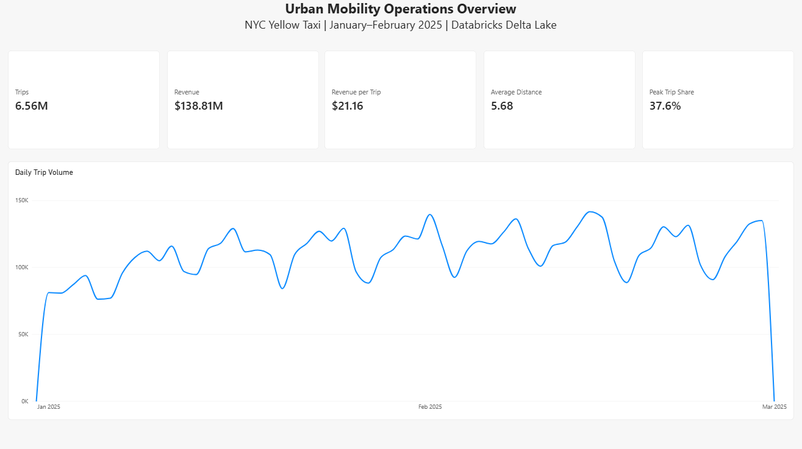
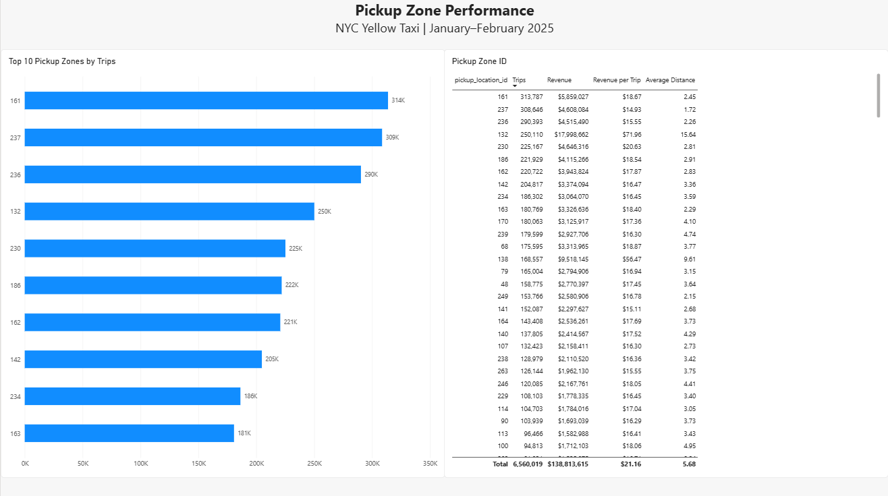
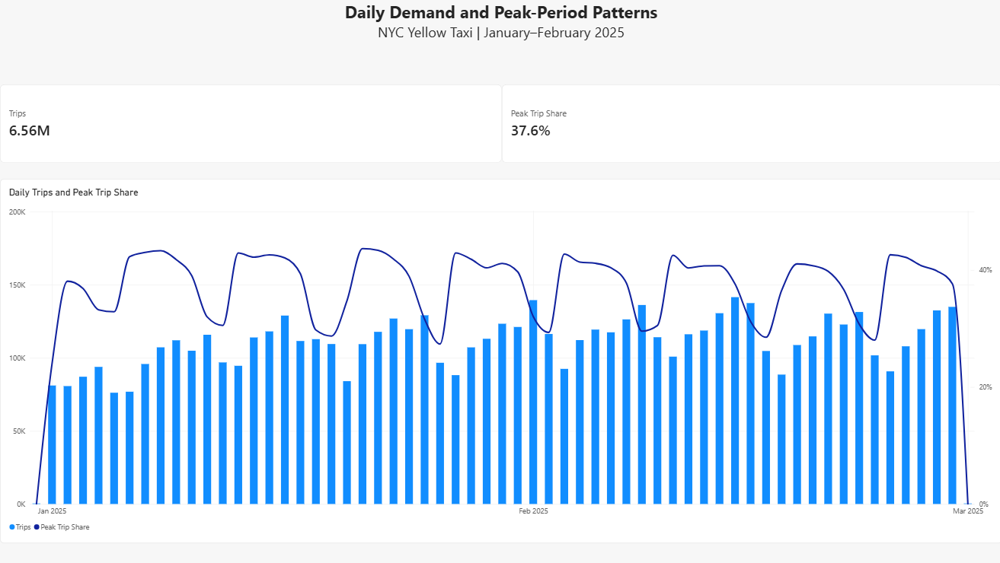
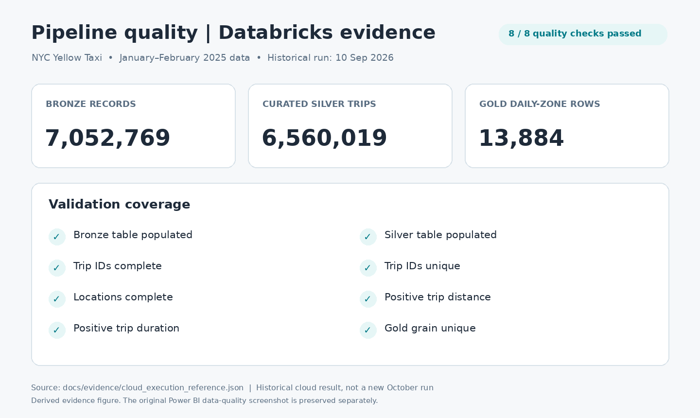
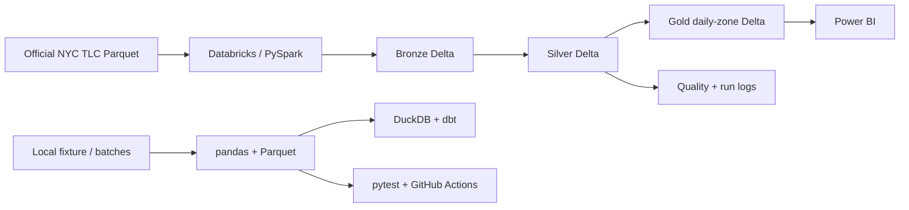

# Urban Mobility Analytics Engineering

**An end-to-end NYC taxi analytics platform built around Databricks, Delta Lake, validated medallion pipelines, SQL modeling, and Power BI reporting.** Designed to transform multi-million-row trip files into reliable operational metrics while supporting idempotent ingestion, historical late arrivals, and data-quality monitoring.

**Databricks · PySpark · Delta Lake · Python · dbt · DuckDB · Power BI · GitHub Actions**



[**Dashboard gallery**](#dashboard-gallery) · [**Results**](#selected-results) · [**Architecture**](#solution-architecture) · [**Cloud execution**](docs/databricks_execution.md) · [**Engineering validation**](docs/ENGINEERING_VALIDATION_v1.md)

## Project overview

Official NYC TLC Yellow Taxi data arrives as large Parquet files that can contain incomplete records, duplicated trips, and out-of-order batches. This project implements a **Bronze → Silver → Gold** pipeline to preserve source traceability, validate trip-level records, maintain unique trip keys, and serve daily pickup-zone metrics to Power BI.

The Databricks implementation uses PySpark and Delta Lake tables. A separate offline implementation uses pandas, Parquet, DuckDB, and dbt to exercise transformations and quality contracts in CI without cloud credentials.

## Selected results

| Area | Verified result | Evidence |
|---|---|---|
| Databricks ingestion | **7,052,769 Bronze** records across January–February 2025 | [Cloud run history](docs/databricks_execution.md) |
| Curated data | **6,560,019 Silver** trips; **13,884 Gold** daily-zone rows | [Execution reference](docs/evidence/cloud_execution_reference.json) |
| Quality assurance | **8/8 Databricks checks** passed in the documented historical run | [Data-quality dashboard](docs/images/data_quality.png) |
| Incremental behavior | January arrived after February; **33 historical partitions** refreshed | [Execution details](docs/databricks_execution.md) |
| Power BI | **$138.81M** recorded revenue; **$21.16** per trip; **5.68 miles** average trip distance | [Dashboard gallery](#dashboard-gallery) |
| Local pipeline | Added corrected-date refresh, trip/revenue reconciliation, and run lineage; test results verified by automated checks | [Engineering validation](docs/ENGINEERING_VALIDATION_v1.md) |

*Cloud figures come from the previously documented September 10, 2026 Databricks executions, not a new cloud benchmark. The local test fixture is separate from the two-month taxi dataset.*

## Dashboard gallery

The four-page Power BI report focuses on operational demand, geographic performance, trip patterns, and pipeline assurance.

| Operations overview | Zone performance |
|:---:|:---:|
| [](docs/images/operations_overview.png) | [](docs/images/zone_performance.png) |
| Revenue, trips, distance, and daily demand | Pickup-zone activity and comparative metrics |

| Time patterns | Pipeline quality — documented evidence |
|:---:|:---:|
| [](docs/images/time_patterns.png) | [](docs/images/cloud_quality_evidence.png) |
| Demand seasonality and peak-period share | Clear view of the **September 10, 2026 historical cloud run** |

The quality figure above is a **derived evidence graphic, not a Power BI screenshot**. The original, unmodified [Power BI Data Quality page](docs/images/data_quality.png) remains available. [Quality figure provenance](docs/QUALITY_EVIDENCE_GUIDE.md).

[Power BI measures and report design](docs/power_bi.md)

## Data engineering and reliability

The core challenge is not charting taxi records—it's preserving trustworthy analytical outputs across reruns and batches received out of chronological order.

- **Medallion architecture:** source-aligned Bronze; validated, trip-grain Silver; daily pickup-zone Gold.
- **Deduplication and reruns:** deterministic trip identifiers and Delta `MERGE` in Databricks; idempotent key-based Silver upserts in the local pipeline.
- **Late-arriving corrections:** local incremental refresh now includes both the **previous and updated pickup dates** when an existing trip changes date, preventing stale historical Gold rows.
- **Quality gates:** row uniqueness, duration and distance validity, location completeness, Gold grain, trip-count reconciliation, and revenue reconciliation.
- **Observability:** cloud quality/run-log Delta tables; local source fingerprints, refreshed-date lists, batch accounting, and append-only execution summaries.
- **Analytics serving:** Gold metrics feed Power BI; dbt staging and incremental marts enforce an independent SQL model in CI.

These local reliability additions do not imply that the original Databricks notebook was rerun. [Read the validation record](docs/ENGINEERING_VALIDATION_v1.md).

## Solution architecture



The cloud and local paths implement comparable layer responsibilities but are **different runtimes with different transactional guarantees**. [Architecture design](docs/architecture.md) · [Databricks execution notes](docs/databricks_execution.md)

## Repository map

| Location | Contents |
|---|---|
| [`databricks/`](databricks/) | PySpark/Delta medallion notebook and cloud ingestion logic |
| [`src/`](src/) | Local transformations, quality contracts, batch lineage, and ingestion |
| [`models/`](models/) | dbt staging and pickup-zone mart models |
| [`docs/`](docs/) | Cloud run evidence, architecture, reporting, and validation notes |
| [`docs/images/`](docs/images/) | Actual Power BI dashboard screenshots |
| [`tests/`](tests/) | Quality-gate, late-arrival, reproducibility, and original transformation tests |

<details>
<summary><strong>Local execution and reproducibility</strong></summary>

Python 3.12, Windows PowerShell:

```powershell
py -3.12 -m venv .venv
.\.venv\Scripts\Activate.ps1
python -m pip install -r requirements.txt
python -m pytest -q
python -m ruff check src tests
python -m src.pipeline --sample
dbt build --profiles-dir .
```

Additional local CSV or Parquet batch:

```powershell
python -m src.pipeline --input path/to/local_batch.csv
```

The run summary, run history, Bronze/Silver/Gold Parquet datasets, and local database are generated locally and excluded from the repository.

</details>

## Source and scope

**Source:** [NYC Taxi & Limousine Commission Trip Record Data](https://www.nyc.gov/site/tlc/about/tlc-trip-record-data.page).

This is a technical research/portfolio implementation, not an operated transportation production system. The current Databricks evidence covers Yellow Taxi records from January and February 2025. The local dbt mart has a documented 62-day lookback limitation for arbitrarily old corrections; production ingestion, alerting, and cost controls would require additional infrastructure. [Engineering boundaries and test evidence](docs/ENGINEERING_VALIDATION_v1.md).

---

**Rishi Ratnakar** · [GitHub](https://github.com/RishiRatnakarData) · [LinkedIn](https://www.linkedin.com/in/rishi-ratnakar/)
